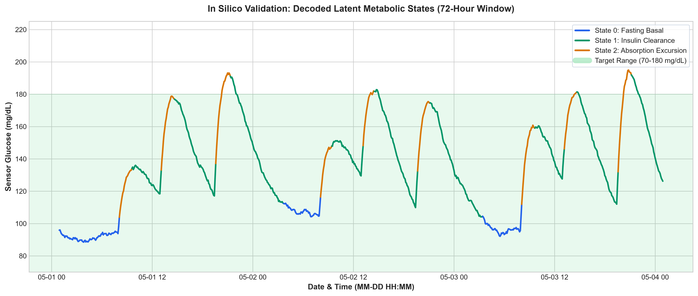
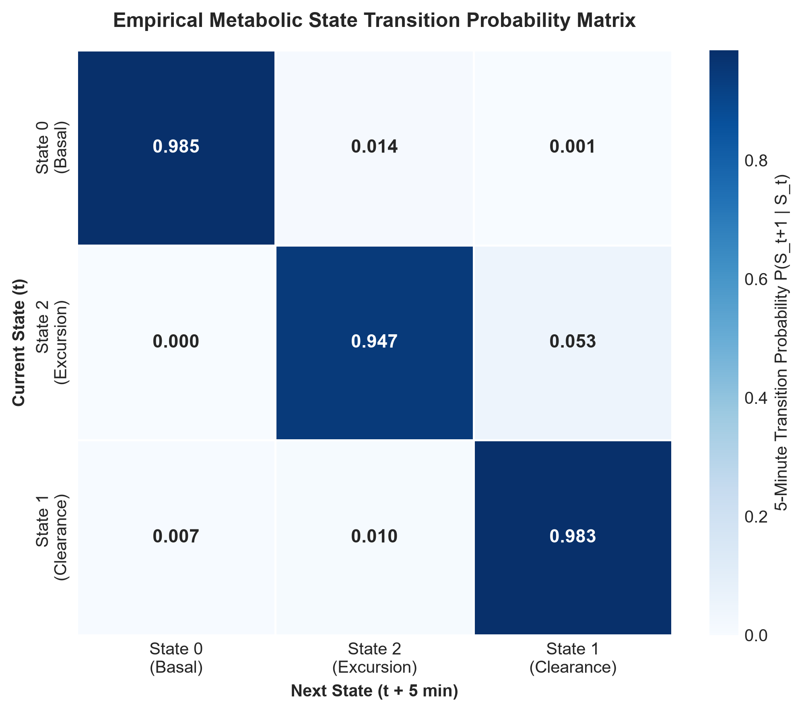

# Project C: Metabolic State Modeller

Can a model work out what's happening metabolically (fasting, digesting a meal, clearing glucose) from continuous glucose monitor (CGM) readings alone, with no labels? I built a glucose simulator with known ground truth and tested whether a Gaussian Hidden Markov Model could recover its hidden states.

[](https://python.org)
[](https://hmmlearn.readthedocs.io/)
[](https://scikit-learn.org)
[](LICENSE)

---

## What this is (and isn't)

This is a **method check on simulated data**, not a discovery about real physiology. The "true" states come from the rules inside my simulator. A good score shows the HMM can recover known structure from glucose alone. It doesn't show that these states map neatly onto real human biology.

I started with simulated data because the standard real dataset, OhioT1DM, needs a signed data use agreement. Testing on real CGM data is the next step.

---

## Data

A 14-day simulated CGM trace at 5-minute intervals (4,021 time points, glucose 88 to 211 mg/dL, mean 133 mg/dL), with three ground-truth states:

| State | Share of time | What it looks like |
|---|:---:|---|
| Fasting (basal) | 31.6% | Flat, around 99 mg/dL |
| Meal absorption | 18.3% | Rising fast (about +0.6 mg/dL/min) |
| Insulin clearance | 50.1% | Falling back (about −0.2 mg/dL/min) |

---

## Method

1. **Features:** 30-minute smoothed glucose, rate of change over 15 minutes, and 1-hour rolling variability.
2. **Model:** Gaussian HMM (hmmlearn) with several random restarts.
3. **Choosing the number of states:** compared BIC with the Adjusted Rand Index (ARI) against ground truth for 2 to 6 states.
4. **Analysis:** transition probabilities, how long the model stays in each state (compared with a simulated Markov null), recovery after meals, and standard clinical glucose metrics for each state.

---

## Results

### 1. Three states recovered without labels (ARI 0.78)

| True state | Decoded basal | Decoded clearance | Decoded absorption | Correctly recovered |
|---|:---:|:---:|:---:|:---:|
| Fasting (n = 1,265) | **1,064** | 197 | 4 | 84.1% |
| Clearance (n = 2,020) | 0 | **1,984** | 36 | 98.2% |
| Absorption (n = 736) | 14 | 50 | **672** | 91.3% |

Most of the errors are fasting periods labelled as clearance. That makes sense, since the tail end of clearance looks a lot like a flat baseline.

### 2. BIC and ARI disagree about the number of states

| States (k) | BIC | ARI |
|:---:|:---:|:---:|
| 2 | 21,700 | 0.34 |
| **3** | 11,576 | **0.78** |
| 4 | 7,939 | 0.59 |
| 5 | 4,749 | 0.45 |
| 6 | 3,210 | 0.42 |

BIC keeps improving as states are added, because it rewards splitting a continuous signal into ever-smaller pieces. ARI peaks at 3. With real data there'd be no ground truth to check against, so this is a useful warning about relying on BIC alone for time series.

### 3. Transitions follow the meal cycle

| From \ To | Basal | Absorption | Clearance |
|---|:---:|:---:|:---:|
| **Basal** | 0.985 | 0.014 | 0.001 |
| **Absorption** | 0.000 | 0.947 | 0.053 |
| **Clearance** | 0.007 | 0.010 | 0.983 |

The model found the cycle basal → absorption → clearance → basal on its own. Transitions in the reverse direction happen less than 1% of the time.

### 4. Time spent in each state looks like a simple Markov process

Median time per visit: basal 282.5 min, clearance 300 min, absorption 95 min. Compared against 1,000 simulated Markov sequences, none of these differed clearly (p = 0.29, 0.06 and 0.05). How long the model stays in a state is explained by the transition probabilities alone, with no extra "memory".

### 5. Adding insulin data made it worse

Adding insulin-on-board (IOB) as a fourth feature dropped ARI from 0.78 to 0.69. I'd expected the opposite. My best explanation is that IOB decays smoothly between meals and dominated the features, so the model started splitting time by insulin decay phase instead of by glucose behaviour.

### 6. Meals and recovery

- 38 meals were logged. The model flagged 15 as absorption episodes (39.5%). Smaller meals cause gentler rises that the model folds into the clearance state, so it picks up the big spikes rather than every meal.
- 14 of those 15 episodes returned fully to basal, after a median of 6.3 hours.

| Decoded state | Samples | Time in range (70-180) | Time above 180 | Variability (CV) |
|---|:---:|:---:|:---:|:---:|
| Basal | 1,078 | 100% | 0% | 4.8% |
| Clearance | 2,231 | 93.5% | 6.5% | 16.0% |
| Absorption | 712 | 80.6% | 19.4% | 14.6% |

---

## Figures



*Simulated CGM trace coloured by the state the HMM assigned at each time point.*



*Transition probabilities between states, ordered basal → absorption → clearance.*

---

## Limitations

- The ground truth comes from the simulator's own rules, not from measured biology.
- The simulator is deterministic, so recovery times are far more regular than real data would be (IQR only 0.8 hours).
- It's one simulated patient over 14 days.
- Nothing has been tested on real CGM data yet.

---

## Running it

```bash
git clone https://github.com/dumkeleosaje/metabolic-ai-portfolio.git
cd metabolic-ai-portfolio/project-c-state-modeller
pip install -r requirements.txt

python src/load_simulation.py     # generate the simulated CGM trace
python src/extract_features.py    # smoothed glucose, rate of change, variability
python src/fit_hmm.py             # fit the HMM and compare BIC with ARI
python src/evaluate_states.py     # transitions, dwell times, recovery, clinical metrics
python src/plot_trajectories.py   # figures

pytest tests/
```
